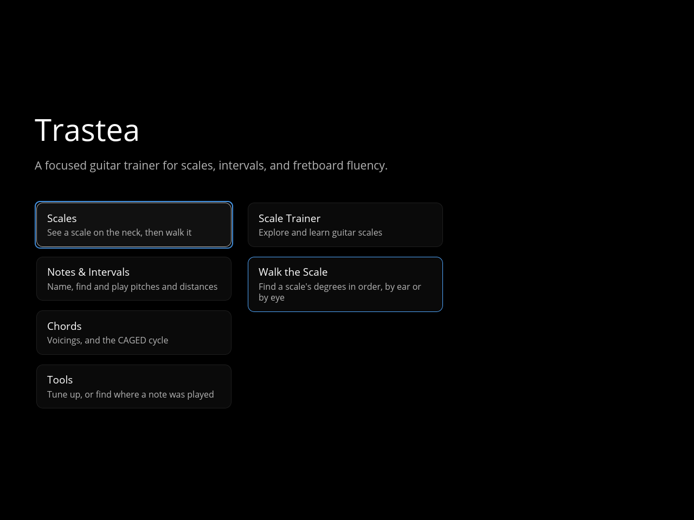
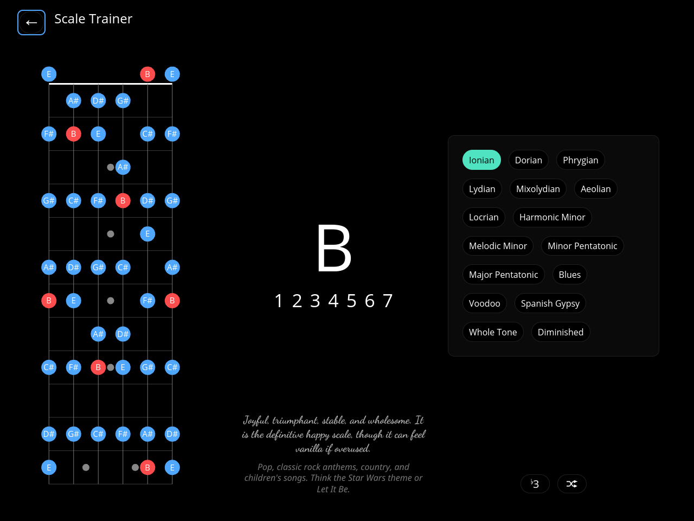
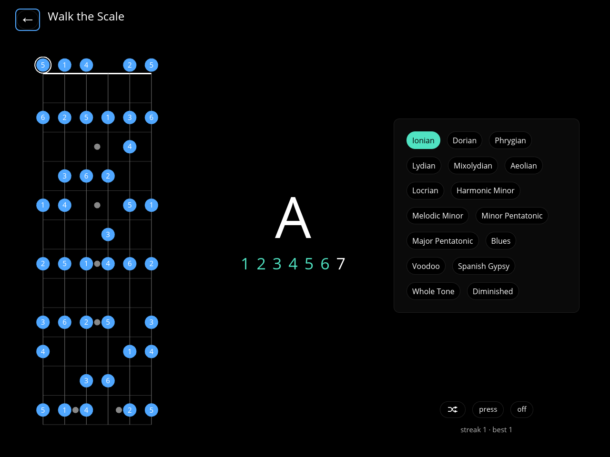
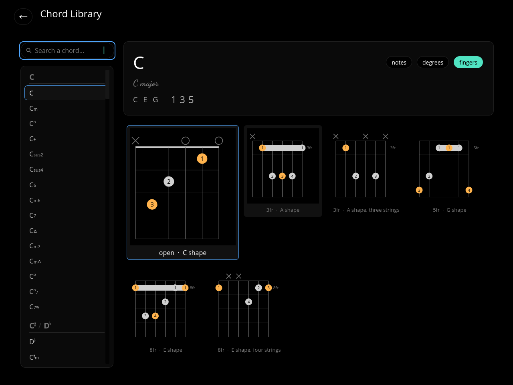
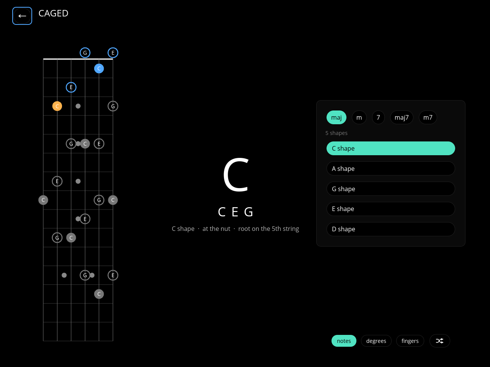
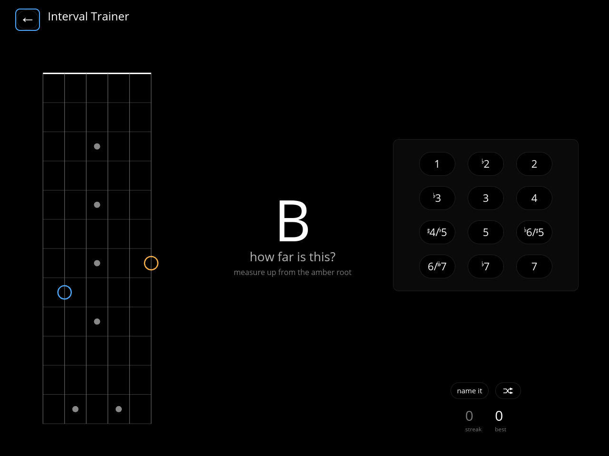

# Trastea

[](https://github.com/DanielSRojo/trastea/actions/workflows/ci.yaml)
[](https://github.com/DanielSRojo/trastea/actions/workflows/audit.yaml)
[](https://crates.io/crates/trastea)
[](Cargo.toml)
[](LICENSE)

A keyboard-driven guitar trainer for the desktop, written in Rust with
[iced](https://iced.rs) 0.14. It draws a neck in standard tuning and drills scale
degrees, note names and intervals against it — or listens to a guitar plugged into an
audio interface.

> **Status: early.** Every screen works. The chord library's shape table is the part
> still worth growing: five CAGED shapes and a handful of reduced ones cover the fifteen
> qualities, and every chord it offers is one a hand can hold.

## Screenshots

| | |
| --- | --- |
| [](assets/screenshots/home.png) | [](assets/screenshots/scale-trainer.png) |
| **Home** | **Scale Trainer** |
| [](assets/screenshots/walk-the-scale.png) | [](assets/screenshots/chord-library.png) |
| **Walk the Scale** | **Chord Library** |
| [](assets/screenshots/caged.png) | [](assets/screenshots/interval-trainer.png) |
| **CAGED** | **Interval Trainer** |

## Screens

- **Scale Trainer** — every degree of a scale lit on the neck. Sixteen kinds, from the
  modes to whole tone and diminished. The scale names itself, so there is no ♯/♭ setting
  to get wrong.
- **Walk the Scale** — the Scale Trainer's picture asked as a question: find one degree
  at a time, in order, by pressing or by playing.
- **Note Trainer** — *name it* lights a position and asks which note it is; *find it*
  names a note and asks you to locate it. Playing mode also asks which string.
- **Interval Trainer** — *name it* shows a root and a target; *find it* names a distance
  to locate. Judged by semitones, so the tritone is one answer.
- **Play the Interval** — the same *find it* prompt, answered on the guitar. Judged by
  pitch class, in any octave.
- **Chord Library** — twelve roots by fifteen qualities, searchable by symbol or name.
  Shows notes, degrees and fingerings as chord diagrams.
- **CAGED** — one chord's shapes tiled along a single fifteen-fret neck, with roots
  filled and shared frets highlighted.
- **Tuner** — chromatic, with cents and a dial. Listens to the loudest input.
- **Position Finder** — *where did I just play that?* Uses each string's inharmonicity
  to tell apart positions that sound the same pitch. Needs a short calibration first.

Everything is reachable from the keyboard; the mouse is optional. Press `?` on any
screen to see the keys that work there.

## Install

### With cargo

```sh
cargo install trastea --locked
```

This builds against the `Cargo.lock` CI tested and puts a `trastea` binary in
`~/.cargo/bin`. It is the route for anything the release archives do not cover, and the
only one that needs a Rust toolchain. Pin an older release with `--version 0.2.0`, or
reinstall with `--force`.

On Linux, `cpal` builds against ALSA, so the headers are needed too:
`libasound2-dev` on Debian and Ubuntu, `alsa-lib` on Arch, `alsa-lib-devel` on Fedora.
Without them the build stops in a `pkg-config` error from a build script, not from a
broken crate.

### From a release archive

The [releases page](https://github.com/DanielSRojo/trastea/releases) carries, per tag:

| File | What it is |
| --- | --- |
| `trastea-vX.Y.Z-x86_64-linux.tar.gz` | the binary |
| `trastea-vX.Y.Z-aarch64-macos.zip` | a `Trastea.app` bundle for Apple silicon |
| `SHA256SUMS` | checksums covering both |

On Linux:

```sh
sha256sum --check --ignore-missing SHA256SUMS
tar -xzf trastea-v0.2.0-x86_64-linux.tar.gz
install -Dm755 trastea-v0.2.0-x86_64-linux/trastea ~/.local/bin/trastea
```

On macOS, unzip and move `Trastea.app` into `/Applications`. The bundle is neither
signed nor notarized, so Gatekeeper refuses the first launch — open it once with
**Open** from the context menu, or clear the quarantine flag:

```sh
xattr -dr com.apple.quarantine /Applications/Trastea.app
```

## Running

```sh
cargo run          # launch the app
cargo test         # unit tests, no UI harness needed
```

Two dependencies: `iced` (with `canvas` and `smol`) and `cpal` for audio capture. Pitch
detection is arithmetic in `audio/detect.rs`, not a third crate. Fonts under `assets/`
are embedded at compile time.

On NixOS there is no global place for headers to land; `nix develop` enters a shell with
ALSA, `pkg-config`, the window libraries and the pinned toolchain.

Contributors can install [`just`](https://just.systems) and run `just` to list the
recipes. `just ci` runs the same gate CI does: fmt-check, lint, test, build.

## Keyboard model

The focus ring is a 2-D grid, so the arrows move the way the layout looks.

| Key | Action |
| --- | --- |
| `⇥` / `⇤` | next / previous |
| `↑ ↓ ← →`, `k j h l` | move the focus ring |
| `Ctrl+K` `Ctrl+J`, `Ctrl+P` `Ctrl+N` | up / down, anywhere the arrows work |
| `Enter`, `Space` | activate |
| `Esc`, `Backspace` | back |
| `?` | the keys for this screen |
| `1`–`9` | on Home, pick a category, then an entry |

Per-screen keys worth knowing:

| Key | Action |
| --- | --- |
| `m` | swap pressing for playing, on drills that accept both |
| `d` | swap direction; on screens that listen, pick the input device |
| `r` | replace what is on screen, or skip the current prompt |
| `[` `]` | step the root down and up |
| `i` | cycle the notation or toggle the spelling |
| `n` `d` `f` | on the Chord Library and CAGED, show note names, degrees or fingers |
| `n` | hide the neck while playing Walk the Scale |
| `t` / `p` | on Walk the Scale, set a timer / start another run |
| `a` | include accidentals on the Note Trainer |
| `/` | open the Chord Library's search box |
| `gg` / `G` | jump to the Chord Library's first / last chord |
| `c` / `g` | on Position Finder, walk a calibration / show predicted groups |

A key claimed by two screens may mean different things on each. The `?` overlay is
generated from the same table as the bindings, so it always says what is actually bound.

## Layout

```
src/
  main.rs        window, theme, embedded fonts
  rng.rs         seedable splitmix64, so drills are reproducible
  music/         theory: notes, pitch, intervals, scales, chords
  audio/         samples in, hertz out; knows nothing about notes
  ui/            App, screens, canvases, and the shared instrument knowledge
docs/            why the code is shaped the way it is
```

The split is load-bearing: `music/` never imports iced, and `ui/` holds no theory of its
own. `audio/` reports hertz and nothing about notes, which keeps the detector testable
without a device. Instrument knowledge — the tuning, the neck, shapes, calibration — sits
in `ui/` beside the screens that use it.

The reasoning behind those boundaries, the spelling arithmetic, the detector, the drills
and the canvases lives in [`docs/`](docs/): `music.md`, `audio.md`, `ui.md`, `drills.md`
and `shapes-and-canvases.md`.

## Testing

Tests live in-module next to what they cover. Music modules test spelling and interval
arithmetic directly; UI tests drive `App::update` with synthesized messages and assert on
state. The seeded RNG makes prompt sequences reproducible, so drills are testable without
rendering anything.

The exhaustive ones are deliberate, because the domain is small enough to walk: every
chord on every root is spelled and checked for repeated letters, every offered voicing is
checked to sound only that chord's notes and stay within a hand, and every root's CAGED
cycle is checked to spell a rotation of C-A-G-E-D. The two canvases each hold a
round-trip test so drawing and hit-testing cannot drift apart.

## License

Trastea is free software under the [GNU General Public License, version 3 or
later](LICENSE). A version you pass on has to reach its users under those same terms,
source included.

The embedded fonts are under the [SIL Open Font License 1.1](assets/fonts/OFL.txt):
Leland Text © MuseScore BVBA, Dancing Script © the Dancing Script Project Authors, and
Noto Sans Math © Google LLC, subset by `just fonts` to the six arrows the chrome draws.
The crates are linked statically, so their notices travel with the binary;
`just notices` renders `THIRD-PARTY-NOTICES.txt` from `about.toml`, and the release
stages it beside the licence.
